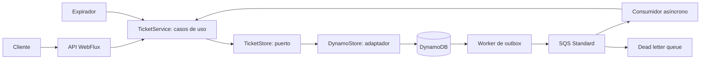

# Reactive Ticketing

Backend de referencia para entradas de admisión general, con reservas temporales, órdenes asíncronas, prevención de sobreventa, cortesías y auditoría transaccional. Usa **Java 25, Spring Boot 4.0.0, WebFlux, DynamoDB Local y SQS Standard mediante LocalStack**. Los nombres y comentarios del código están en inglés.

## Entregables

| Entregable | Ubicación |
|---|---|
| Código con Clean Architecture | `src/main/java/com/example/ticketing/{domain,application,infrastructure}` |
| Unit tests: JUnit 5, Mockito, reactor-test y WebTestClient | `src/test/java/com/example/ticketing` |
| Integración real DynamoDB | `DynamoIntegrationTest.java` |
| Cobertura JaCoCo, sin exclusiones | `reports/unit/coverage/index.html` |
| Evidencia de validación | `VALIDATION.md`, `reports/unit`, `reports/integration` |
| Colecciones Postman | `postman/ticketing.postman_collection.json`, `postman/expiration.postman_collection.json` |
| Infraestructura y aplicación | `docker-compose.yml`, `Dockerfile`, `infra/` |
| Carga k6 | `tests/load.js` |
| Guía para sustentación técnica | `docs/TECHNICAL_REVIEW.md` |
| Diagramas de arquitectura y secuencia | `docs/ARCHITECTURE.md`, `docs/diagrams/` |
| Infraestructura AWS como código | `infra/terraform/README.md` |
| Costos, operación, gobernanza y evolución | `docs/AWS_OPERATIONS.md` |

## Instalación con Docker

Requisitos: Docker Engine o Docker Desktop en modo contenedores Linux, plugin Docker Compose y acceso a Maven Central y a los registros de imágenes. Los puertos 8080, 8000 y 4566 deben estar libres. No hace falta instalar Java o Maven en el host para esta modalidad.

Desde la raíz del repositorio:

```sh
# Opcional: copiar .env.example a .env y cambiar la clave administrativa local.
docker compose up --build -d
docker compose logs -f app
```

Compose inicia DynamoDB Local, LocalStack, un inicializador de tabla/GSI/colas/DLQ y la aplicación. El inicializador espera disponibilidad de DynamoDB y LocalStack; la aplicación solo arranca si termina correctamente. La compilación del contenedor ejecuta `mvn verify` con el umbral de cobertura activado.

API: `http://localhost:8080/api`. DynamoDB: `http://localhost:8000`. LocalStack: `http://localhost:4566`.

```sh
docker compose ps
docker compose logs infrastructure-init
docker compose --profile test run --rm tests
docker compose down
```

`down` conserva el volumen DynamoDB. No eliminar el volumen si se necesita conservar el inventario. LocalStack es efímero en esta configuración local; la recuperación durable de SQS debe evaluarse con persistencia apropiada o AWS real.

## Ejecución sin Docker

Instalar JDK 25 y Maven 3.9 o superior. Iniciar DynamoDB Local y un servicio SQS compatible; crear la tabla a partir de `infra/table.json` y las colas con los parámetros de `infra/queue-init.sh`.

Variables para desarrollo:

| Variable | Valor local / propósito |
|---|---|
| `DYNAMODB_ENDPOINT` | `http://localhost:8000` |
| `DYNAMODB_TABLE` | `ticketing` |
| `SQS_ENDPOINT` | `http://localhost:4566` |
| `SQS_URL` | `http://localhost:4566/queue/us-east-1/000000000000/orders` |
| `AWS_ACCESS_KEY_ID` | `test` para servicios locales |
| `AWS_SECRET_ACCESS_KEY` | `test` para servicios locales |
| `AWS_REGION` | `us-east-1` |
| `TICKETING_ADMIN_KEY` | Clave de desarrollo del endpoint de cortesías |

```sh
mvn clean verify
mvn spring-boot:run
```

Sin `TICKETING_ADMIN_KEY`, las cortesías se rechazan con 403. Compose configura `local-demo-change-me` para la demostración; puede reemplazarse desde `.env`. El SDK utiliza `DefaultCredentialsProvider`; en AWS se deben usar roles IAM con permisos mínimos.

## Arquitectura y decisiones



- **Dominio:** records y estados, sin Spring, SDK AWS ni anotaciones de persistencia.
- **Casos de uso:** reglas de reserva, confirmación, rechazo, expiración y retries. Dependen de `TicketStore` y un `Clock` inyectado; no conocen DynamoDB ni SQS.
- **Infraestructura:** controladores, manejo HTTP de errores, SDKs asíncronos, scheduler y persistencia. `Configuration` realiza el ensamblaje por inyección de dependencias.
- **Patrones:** arquitectura de puertos/adaptadores, repository, máquina de estados, transactional outbox, consumidor idempotente, comparación y actualización condicional, retry con backoff y jitter.
- **SOLID:** reglas separadas de transporte/persistencia; puertos para sustituir infraestructura; dependencias hacia adentro; composición e inyección en vez de herencia de implementación. El puerto agrupa operaciones que comparten la frontera transaccional de órdenes e inventario.

La API y los workers retornan `Mono`/`Flux`. El SDK asíncrono de AWS se integra con `Mono.fromFuture`; no hay `block()`, `subscribe()` manual ni esperas de hilos en producción. Las esperas de los scripts de inicialización no forman parte del procesamiento WebFlux. No se requieren virtual threads para estos clientes no bloqueantes.

### Modelo DynamoDB

Tabla con clave primaria `pk` y GSI `kind-sort-index` (`kind`, `sort`, proyección ALL):

| Entidad | pk | kind | sort |
|---|---|---|---|
| Evento e inventario | EVENT#eventId | EVENT | eventId |
| Orden sin reserva activa | ORDER#orderId | ORDER | orderId |
| Orden reservada/en confirmación | ORDER#orderId | ACTIVE | vencimiento en milisegundos con padding + orderId |
| Outbox | OUTBOX#id | OUTBOX | id |
| Auditoría | AUDIT#id | AUDIT#orderId | instante con padding + id |

Las consultas por identificador usan lecturas fuertemente consistentes. Las listas, auditoría, outbox y vencimientos usan GSI, que es eventualmente consistente. Todas las páginas del GSI se recorren con el paginator del SDK. El publicador toma hasta 100 registros por ciclo; el consumidor maneja hasta 10 mensajes por lote y el expirador limita a 8 transiciones simultáneas.

### Prevención de sobreventa y duplicados

Cada transición usa `TransactWriteItems` para cambiar atómicamente la orden, los contadores, la auditoría y, si corresponde, el outbox. La escritura de la orden exige su estado anterior; el inventario exige `source >= quantity`. El estado anterior basta como control optimista porque ninguna orden vuelve a un estado previo. Una carrera aborta toda la transacción y el caso de uso vuelve a leer antes de reintentar.

Invariante: `capacity = available + reserved + pending + sold + complimentary`, con contadores no negativos. El snapshot leído por el consumidor es orientativo: la condición de escritura se evalúa en la base de datos.

La clave `Idempotency-Key` identifica la orden durante toda su vida. Repetir clave y payload devuelve la misma orden; cambiar evento, cliente, cantidad o condición de cortesía devuelve 409. La creación condicional impide órdenes duplicadas. Cada solicitud transaccional del SDK lleva además un `clientRequestToken`; la idempotencia del negocio no depende de su ventana temporal.

### Mensajería y fallos

El POST guarda orden QUEUED, auditoría y outbox en una transacción y retorna 202 sin esperar al broker. El publicador envía a SQS y elimina el registro de outbox después del acuse. Una caída entre envío y eliminación puede duplicar el mensaje, pero no la transición de negocio.

SQS Standard entrega al menos una vez. Se usa long polling de 10 segundos, visibility timeout de 60 segundos, retención de cuatro días y DLQ después de 8 recepciones fallidas. El consumidor elimina el mensaje únicamente tras completar la transacción. Si falla el procesamiento, deja que SQS lo reentregue. Los workers registran el fallo y el siguiente ciclo vuelve a intentar; los casos de uso limitan a 8 retries con backoff para conflictos/errores transitorios.

Un 202 significa **orden durable aceptada**, no reserva ni venta garantizada. Si SQS cae, las órdenes permanecen en el outbox. Si DynamoDB falla antes del commit, no se acepta una orden no persistida.

## Estados y flujos

Las entradas tienen cinco estados: AVAILABLE, RESERVED, PENDING_CONFIRMATION, SOLD y COMPLIMENTARY. Las órdenes necesitan también QUEUED, REJECTED y EXPIRED para describir el procesamiento. En esos tres estados `ticketState` es nulo porque no hay entradas asignadas; AVAILABLE se representa en el inventario.

| Acción | Estado de orden | Movimiento de entradas |
|---|---|---|
| Crear compra | QUEUED | Todavía sin asignación |
| Consumidor con cupo | RESERVED | AVAILABLE → RESERVED |
| Consumidor sin cupo | REJECTED | Sin movimiento |
| Confirmar reserva | PENDING_CONFIRMATION | RESERVED → PENDING_CONFIRMATION |
| Consumidor con confirmación vigente | SOLD | PENDING_CONFIRMATION → SOLD |
| Vencer reserva/confirmación | EXPIRED | RESERVED/PENDING_CONFIRMATION → AVAILABLE |
| Asignar cortesía | COMPLIMENTARY | AVAILABLE → COMPLIMENTARY |

La reserva vence a los 600 segundos desde su asignación; confirmar no extiende el plazo. Confirmación y consumidor comprueban la fecha; el expirador consulta cada segundo. Un atraso de GSI, scheduler o servicio puede conservar inventario vencido temporalmente descontado: no se revende hasta liberarlo atómicamente. SOLD y COMPLIMENTARY no tienen transiciones de salida.

RESERVED y PENDING_CONFIRMATION no representan ventas. Solo SOLD representa unidades vendidas; COMPLIMENTARY consume inventario sin venta contable. La auditoría se guarda en la misma transacción de cada transición.

## API y ejemplos

| Método | Endpoint | Resultado |
|---|---|---|
| POST | /api/events | Crear evento, 201 |
| GET | /api/events | Listar eventos |
| GET | /api/events/{id}/availability | Disponibilidad y contadores actuales |
| POST | /api/orders | Crear orden durable, 202; requiere Idempotency-Key |
| GET | /api/orders/{id} | Orden y ticketState |
| POST | /api/orders/{id}/confirm | Encolar confirmación, 202 |
| GET | /api/orders/{id}/audit | Historial, eventualmente consistente |
| POST | /api/complimentary-orders | Cortesía, 202; requiere Idempotency-Key y X-Admin-Key |

Cantidad entre 1 y 20 por orden. Idempotency-Key: de 8 a 100 letras, números, guiones o guiones bajos. Validación inválida: 400; recurso inexistente: 404; conflicto de negocio: 409; cortesía no autorizada: 403.

Ejemplos para shell POSIX. En PowerShell usar la colección Postman o adaptar el escapado para `curl.exe`:

```sh
curl -X POST http://localhost:8080/api/events \
  -H 'Content-Type: application/json' \
  -d '{"name":"Concert","date":"2099-06-01T01:00:00Z","venue":"Bogota","capacity":1000}'
# Replace EVENT_ID with the returned identifier.
curl http://localhost:8080/api/events
curl http://localhost:8080/api/events/EVENT_ID/availability
curl -X POST http://localhost:8080/api/orders \
  -H 'Content-Type: application/json' -H 'Idempotency-Key: purchase-demo-0001' \
  -d '{"eventId":"EVENT_ID","customerId":"customer-001","quantity":2}'
curl http://localhost:8080/api/orders/purchase-demo-0001
# Wait for RESERVED before confirming.
curl -X POST http://localhost:8080/api/orders/purchase-demo-0001/confirm
# Poll until SOLD or EXPIRED.
curl http://localhost:8080/api/orders/purchase-demo-0001
curl http://localhost:8080/api/orders/purchase-demo-0001/audit
curl -X POST http://localhost:8080/api/complimentary-orders \
  -H 'Content-Type: application/json' -H 'Idempotency-Key: gift-demo-0001' \
  -H 'X-Admin-Key: local-demo-change-me' \
  -d '{"eventId":"EVENT_ID","customerId":"guest-001","quantity":1}'
```

### Postman

Importar `postman/ticketing.postman_collection.json`, configurar `baseUrl` y `adminKey`, y ejecutar desde la solicitud 01 con Collection Runner y un retraso de 500 ms entre solicitudes. Se crean un evento y claves nuevos en cada ejecución. La colección verifica compra, idempotencia, confirmación, auditoría, cortesía, inventario, rechazo por falta de cupo, validación y errores HTTP. Los polls están acotados a 60 intentos.

La colección separada `expiration.postman_collection.json` deja vencer una reserva sin confirmarla y verifica la devolución de inventario. Ejecutarla con retraso de 1000 ms; tarda unos 10 minutos. `setNextRequest` funciona en el runner, no al pulsar Send individualmente. La lectura de auditoría puede requerir reintento por consistencia eventual del GSI.

## Pruebas y cobertura

```sh
# Pruebas unitarias y cobertura sin servicios externos:
mvn clean verify
# Integración real y pruebas unitarias dentro de la red Compose:
docker compose --profile test run --rm tests
```

Fuera de Compose, definir `TEST_DYNAMODB_ENDPOINT=http://localhost:8000` antes de ejecutar `mvn clean verify` para habilitar `DynamoIntegrationTest`. Crea y elimina tablas aisladas con prefijo `ticketing-test-`; no modifica la tabla de la aplicación.

`mvn verify` falla si la cobertura total de líneas es inferior al 90%. JaCoCo 0.8.14 analiza todas las clases de producción, sin exclusiones. El informe recién generado queda en `target/site/jacoco/index.html`.

La entrega incluye **45 pruebas unitarias correctas, 99,29% de líneas y 98,96% de ramas cubiertas**, medidas con Java 25 sin sumar integración. Los casos de uso y controladores tienen 100% de líneas cubiertas. En la validación inicial también pasaron **2 pruebas de integración con DynamoDB Local real**, incluida competencia de 100 órdenes por capacidad 20 y reentregas duplicadas. Ver `VALIDATION.md` para fechas, versiones y límites de lo ejecutado.

Mockito sustituye el puerto de persistencia en casos de uso. WebTestClient verifica contratos HTTP, validación y manejo de errores. StepVerifier y tiempo virtual prueban flujos reactivos, retries y agotamiento. Las pruebas del adaptador usan un doble atómico del SDK; las de integración comprueban las condiciones y transacciones contra DynamoDB real. Los workers prueban acuse posterior al procesamiento y recuperación de errores de broker/persistencia.

Con k6 instalado y el stack activo:

```sh
k6 run tests/load.js
```

El script presenta 1000 solicitudes con 100 usuarios virtuales contra capacidad 100. Exige p95 de aceptación inferior a 1 segundo y comprueba conservación del inventario. Es un criterio propuesto, **no un rendimiento medido** en esta entrega. Medir por separado tiempo de aceptación y tiempo hasta estado terminal.

## Límites y seguridad

Se modela admisión general por cantidad; no hay selección de butacas numeradas. Para butacas se necesita estado por `eventId + seatId` con escritura condicional, además de la transacción de orden. No hay precios, importes contables ni pasarela de pago: `/confirm` representa la confirmación de negocio de la demostración.

La implementación no tiene autenticación de clientes ni autorización por dueño de orden; el secreto de cortesías es solo protección local básica. Antes de exposición pública: identidad OIDC/JWT, cliente derivado del principal, autorización por recurso, roles administrativos, callback de pago autenticado e idempotente, TLS, rate limiting y gestión de secretos. Nunca aceptar un pago como confirmado solo porque un cliente invoca `/confirm`.

El inventario de un evento es un punto de contención deliberado. WebFlux reduce la ocupación de hilos, pero no elimina límites de una clave caliente. Los GSI globales ACTIVE/OUTBOX también necesitan particionarse al escalar. Medir conflictos, p95/p99, edad del outbox/SQS, DLQ y atraso de expiración; añadir control de admisión y cupos particionados si la demanda lo exige. Más réplicas por sí solas pueden aumentar las carreras.

## Propuesta AWS y valor diferencial

Se añadieron diagramas de componentes, secuencia de compra, confirmación/expiración y carrera por el último cupo. La [documentación de arquitectura](docs/ARCHITECTURE.md) explica cada interacción y distingue código existente, infraestructura definida y evolución futura.

[Terraform](infra/terraform/README.md) define Fargate en dos AZ, ALB interno HTTPS, red privada sin NAT, endpoints de VPC, IAM por rol, DynamoDB/PITR, SQS/DLQ/KMS, ECR y observabilidad. Incluye bootstrap de estado remoto y ejemplos separados por entorno. Se validaron esquemas y **6 escenarios de plan con AWS simulado**, sin desplegar recursos ni usar una cuenta AWS.

El perfil `aws` configura endpoints regionales HTTPS, región explícita y credenciales del task role. Se añadieron shutdown ordenado y `/actuator/health/readiness` y `/actuator/health/liveness`; readiness comprueba el proceso, no todo el flujo de compras. Actuator solo expone health y no muestra detalles.

[Operación y madurez técnica](docs/AWS_OPERATIONS.md) cubre costos, alertas, runbooks, aislamiento, privacidad, RPO/RTO y decisiones que cambiarían en producción. La infraestructura propuesta no corrige por sí misma la ausencia de autenticación de cliente; por eso no crea una entrada pública.

## Referencias

- [Spring Boot 4: soporte Java 25](https://spring.io/blog/2025/11/20/spring-boot-4-0-0-available-now/)
- [DynamoDB: transacciones e idempotencia](https://docs.aws.amazon.com/amazondynamodb/latest/developerguide/transaction-apis.html)
- [SQS: semántica de entrega](https://aws.amazon.com/sqs/faqs/)
- [JaCoCo 0.8.14: soporte Java 25](https://www.jacoco.org/jacoco/trunk/doc/changes.html)
