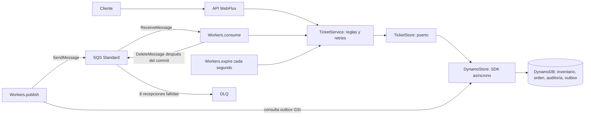
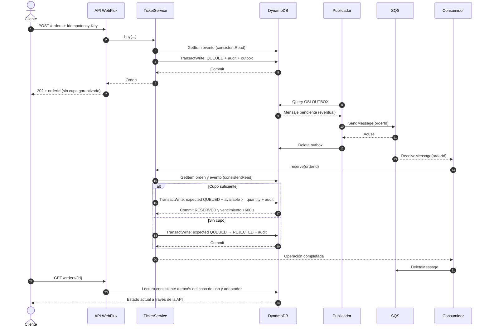
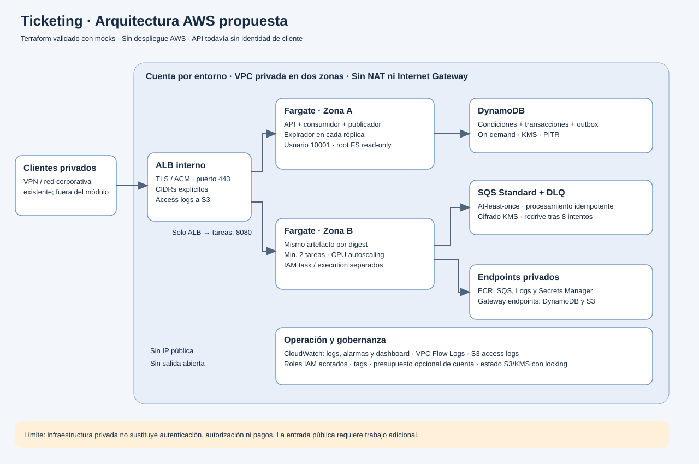
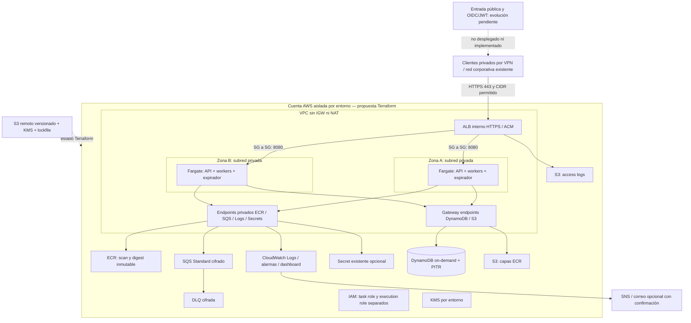

# Diagramas e interacciones

Esta documentación distingue tres niveles: **backend implementado y probado**, **infraestructura AWS definida en Terraform pero no desplegada** y **evoluciones propuestas**. Los diagramas no representan experiencia operativa o resultados de carga no medidos.

## Componentes implementados



| Interacción | Responsabilidad | Consistencia / fallo |
|---|---|---|
| API → caso de uso | Validación HTTP y composición reactiva | 202 después de persistir la orden |
| Caso de uso → TicketStore | Reglas de negocio y retries | El puerto no depende de AWS |
| DynamoStore → DynamoDB | Transacción y condiciones | Orden, inventario y audit se confirman juntos |
| Publicador → SQS | Enviar outbox durable | Puede duplicar envío; no perder por doble escritura |
| Consumidor → caso de uso | Procesar y confirmar estado | DeleteMessage tras completar el commit |
| Expirador → caso de uso | Releer candidatos y liberar | GSI eventual; devolución condicional y conservadora |
| Cliente → disponibilidad | Consultar evento por clave | GetItem fuertemente consistente |

Todos los workers conviven con la API en el **mismo proceso**. Terraform replica ese mismo proceso en Fargate; no se han implementado servicios API y worker independientes.

## Compra y reserva



El cupo se concede en la transición transaccional del consumidor. Un 202 inicial no garantiza reserva. El publicador puede reenviar después de una caída entre send y delete del outbox. Una entrega duplicada de una orden ya procesada no vuelve a mover inventario.

## Confirmación y vencimiento

```mermaid
sequenceDiagram
    autonumber
    actor Client as Cliente
    participant API as API / caso de uso
    participant DB as DynamoDB
    participant Queue as Outbox / SQS / consumidor
    participant Expirer as Expirador
    Client->>API: POST /orders/{id}/confirm
    API->>DB: GetItem orden (consistentRead)
    alt RESERVED y plazo vigente
        API->>DB: TransactWrite: expected RESERVED → PENDING_CONFIRMATION + contadores + audit + outbox
        DB-->>API: Commit (mismo vencimiento)
        API-->>Client: 202
        Queue->>DB: Leer PENDING_CONFIRMATION
        alt Consumidor comprueba plazo vigente
            Queue->>DB: TransactWrite: expected PENDING_CONFIRMATION → SOLD + contadores + audit
            DB-->>Queue: Commit
            Note over Queue,DB: Acuse SQS solo tras completar el commit
        else Consumidor observa plazo vencido
            Queue->>DB: TransactWrite: expected PENDING_CONFIRMATION → EXPIRED + devolver cupo + audit
        end
    else Reserva ya vencida
        API->>DB: TransactWrite: RESERVED → EXPIRED + devolver cupo + audit
        API-->>Client: Estado EXPIRED
    end
    Expirer->>DB: Query GSI ACTIVE con vencimiento <= ahora
    DB-->>Expirer: Candidatos eventualmente consistentes
    Expirer->>DB: Releer cada orden en forma consistente
    Expirer->>DB: Si sigue vencida: transición condicionada y devolución atómica
    Note over DB,Expirer: Si otra transacción ganó, se relee; no se duplica la devolución
    Note over API,Queue: SOLD y COMPLIMENTARY no tienen transiciones de salida
```

La confirmación no extiende los diez minutos. El consumidor comprueba el tiempo antes de intentar la transacción; la condición en DynamoDB protege estado e inventario, no usa un reloj del servidor para condicionar el commit. En producción debe definirse explícitamente el punto de corte del pago, sincronizar relojes y tratar posibles commits cercanos al límite. La liberación física puede retrasarse por GSI, backlog o fallos: no se revende antes de liberar atómicamente.

## Carrera por el último cupo

```mermaid
sequenceDiagram
    autonumber
    participant A as Consumidor A
    participant B as Consumidor B
    participant DB as DynamoDB
    A->>DB: Leer evento: available = 1
    B->>DB: Leer evento: available = 1
    A->>DB: Transacción: orden A QUEUED + available >= 1
    DB-->>A: Commit: available = 0, reserved = 1
    B->>DB: Transacción: orden B QUEUED + available >= 1
    DB-->>B: Condición rechazada; nada de B se persiste
    B->>DB: Retry con backoff: releer orden B y evento
    DB-->>B: Orden B QUEUED, available = 0
    B->>DB: Transacción: B QUEUED → REJECTED + audit
    DB-->>B: Commit sin movimiento de inventario
    Note over A,DB: Leer disponibilidad no concede cupo: la condición del commit decide
```

La lectura orienta la decisión, pero la escritura condicionada decide si puede consumirse cupo. Si la transacción falla, tampoco se guarda un cambio de orden ni auditoría parcial.

## Topología AWS propuesta





Los endpoints privados permiten que tareas sin NAT lleguen a AWS. Las tablas y colas son servicios regionales, **no están dentro de la subred**. El acceso corporativo por VPN/peering y el certificado ACM deben existir; este módulo no crea una VPN, DNS privado ni una plataforma OIDC.

ALB termina TLS y el salto interno hacia la tarea usa HTTP 8080 protegido por security groups. No se ha implementado TLS extremo a extremo entre ALB y contenedor. Ese cambio depende del modelo de amenazas y políticas del entorno.

Los archivos `.mmd` se pueden editar y renderizar con Mermaid; el SVG es una vista estática sin dependencias externas.
